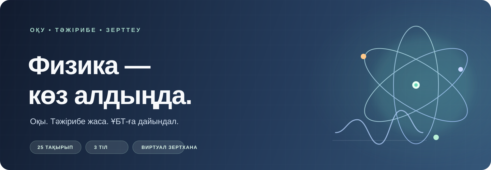

<div align="center">
  
  <br />
  <br />
  <a href="docs/QUICKSTART.md"></a>
  <a href="#мүмкіндіктер"></a>
</div>

<p align="center">
  <a href="https://www.python.org/"></a>
  <a href="https://www.manim.community/"></a>
  <a href="LICENSE"></a>
  
</p>

<p align="center">
  
</p>

<p align="center"><sub>Бір тақырыпты таңда. Өз қарқыныңмен оқы. Әр қадамыңды бақыла.</sub></p>

## Мүмкіндіктер

|  |  |
|:---|:---|
| **Оқу жоспары**<br />Мектеп физикасының негізгі тарауларын түсіндірмелермен және тақырыптық жаттығулармен меңгер. | **ҰБТ / ЕНТ дайындығы**<br />Тақырып бойынша есеп шығар немесе уақытпен шектелген сынақ емтиханын орында. |
| **AI-репетитор**<br />Сұрақ қойып, түсіндірме ал немесе тақырып бойынша толық сабақ құрастыр. | **Виртуалды зертхана**<br />Параметрлерді өзгертіп, физикалық құбылыстың қалай өзгеретінін бірден бақыла. |
| **Кітапхана және дереккөздер**<br />Оқулықтар мен PDF-файлдарды ізде; жауаптағы сілтемеден нақты бетке өт. | **Үш тілде оқу**<br />Қазақша, орысша және ағылшынша интерфейс пен тапсырмаларды пайдалан. |

## Қолданба көрінісі

<table>
  <tr>
    <td align="center" width="50%">
      <a href="ui-screenshots/02-topics.png"></a><br />
      <strong>Тақырыпты таңдап, оқу жолын баста</strong>
    </td>
    <td align="center" width="50%">
      <a href="ui-screenshots/03-unt-practice-setup.png"></a><br />
      <strong>Өзіңе сай жаттығу жоспарын құр</strong>
    </td>
  </tr>
  <tr>
    <td align="center">
      <a href="ui-screenshots/05-ai-tutor.png"></a><br />
      <strong>Сұрақ қойып, жаңа тақырыпты түсін</strong>
    </td>
    <td align="center">
      <a href="ui-screenshots/08-lab.png"></a><br />
      <strong>Зертханада тәжірибе жаса</strong>
    </td>
  </tr>
</table>

## Орнату және іске қосу

### Оқушыларға

PhysLab орнатқышын (`PhysLab-Setup-<нұсқа>.exe`) іске қосып, қолданбаны **Start** мәзірінен аш. Алғашқы жаттығуды бастау үшін [жылдам нұсқаулықты](docs/QUICKSTART.md) қара.

### Бастапқы кодтан іске қосу

Python 3.11 немесе одан кейінгі нұсқа қажет.

```bash
git clone https://github.com/gopheriv/physlab.git
cd physlab
pip install -e ".[rag,render]"
python -m aetherlab
```

> **AI міндетті емес.** AI қызметін қоспай-ақ, PhysLab ішіндегі дайын физика үлгілерімен оқуға болады. Жергілікті әрі құпия AI үшін [Ollama](https://ollama.com)-ны бапта; бұлттағы үйлесімді қызметтерді қолданба баптауларынан қос.

## Есептен анимацияға дейін

Есепті енгізгеннен кейін PhysLab физиканы төрт қадаммен түсіндіреді:

1. **Шешім** — формуласы терілген математикалық шығару жолын дайындайды.
2. **Дереккөздер** — OpenStax оқулықтарынан не өз PDF-файлдарыңнан тиісті беттерді табады.
3. **Көрнекі түсіндіру** — [Manim Community](https://www.manim.community/) арқылы анимациялық көрініс жасайды.
4. **Бейне** — MP4 файлын жасап, рендер қатесін автоматты түрде жөндеуге тырысады.

Интерактивті зертханада ауырлық күші, тербеліс параметрлері сияқты мәндерді өзгертіп, нәтижесін бірден салыстыруға болады.

<details>
  <summary><strong>AI қызметтері және қосымша баптаулар</strong></summary>
  <br />

  PhysLab дайын тақырыптық үлгілермен AI-сыз да жұмыс істейді. Қаласаң, [Ollama](https://ollama.com) жергілікті моделін немесе OpenAI API-мен үйлесімді қызметті **Баптаулар** бөлімінен қоса аласың. Бейне сапасын тексеретін vision-модель — қосымша мүмкіндік.

  Кеңейтілген баптауларда бұрыннан қолданылып келе жатқан `AETHERLAB_*` айнымалылары сақталған:

  `AETHERLAB_OPENAI_API_KEY` / `OPENAI_API_KEY`, `AETHERLAB_OPENAI_BASE_URL`, `AETHERLAB_LLM_MODEL`, `AETHERLAB_VISION_MODEL`, `AETHERLAB_PROVIDER=ollama`, `AETHERLAB_NARRATION=1`, `AETHERLAB_DATA_DIR`, `AETHERLAB_LIBRARY_DIR`, `AETHERLAB_LLM_TIMEOUT`.

  Бұрынғы баптаулар, оқулықтар мен оқу тарихы Windows-та `%LOCALAPPDATA%\AetherLab`, басқа жүйелерде `~/.aetherlab` бумасында сақталады.
</details>

<details>
  <summary><strong>Әзірлеушілерге арналған командалар</strong></summary>
  <br />

  ```bash
  python -m aetherlab --smoke
  python -m aetherlab --version
  python test_features.py
  python build_feature_tracker.py
  python -m pytest -q
  ```

  Windows жүйесінде `start.bat` қолданбаны қате шыққан соң қайта іске қосатын бақылаушымен ашады. Қосымша ақпарат: [ақауларды түзету нұсқаулығы](docs/TROUBLESHOOTING.md), [физика дереккөздері](PHYSICS_SOURCES.md).
</details>

## Лицензия және алғыс

PhysLab [MIT лицензиясымен](LICENSE) таратылады. Анимация [Manim Community](https://www.manim.community/) арқылы жасалады. Бастапқы оқулықтар — [OpenStax](https://openstax.org) (CC BY 4.0), белгішелер — [Lucide](https://lucide.dev) (MIT).

